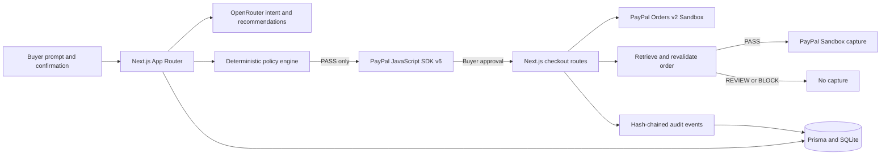

# IntentLock

**Your AI can shop. You control what it can buy.**

IntentLock is a PayPal AI Hackathon prototype that turns natural-language shopping requests into versioned purchase permissions. AI can interpret intent and recommend products; a separate deterministic policy engine decides whether a purchase passes, needs buyer confirmation, or is blocked. PayPal Sandbox buyer approval and server-side order verification remain required for every captured payment.

The seeded catalog is demonstration data, not a live merchant marketplace. The app is restricted to PayPal Sandbox and must never be configured with production credentials.

## What it does

- Compiles a buyer prompt into a Zod-validated, versioned permission policy using OpenRouter.
- Recommends products from the local seeded catalog and explains their policy results.
- Enforces `PASS`, `REVIEW`, and `BLOCK` using deterministic server-side rules.
- Records narrow, buyer-confirmed exceptions as new policy versions; hard blocks cannot be overridden.
- Creates actual PayPal Sandbox Orders v2 orders and uses PayPal JavaScript SDK v6 for buyer approval.
- Re-fetches and validates the real PayPal order, policy version, product, amount, currency, line items, and purchase snapshot before capture.
- Stores actual Sandbox order/capture IDs and builds a hash-chained audit trail.
- Offers an explicitly enabled cart-drift demo that approves a real Sandbox order, simulates adding an unauthorized recurring subscription in a separate local validation context, and blocks capture without changing the PayPal response or capturing funds.

## Architecture



### Technology

- Next.js App Router, React, TypeScript, Tailwind CSS, Lucide icons
- Prisma ORM and SQLite
- OpenRouter API with the OpenAI-compatible Node SDK and structured policy output
- PayPal JavaScript SDK v6 and PayPal Orders v2 REST API (Sandbox only)
- Zod, Vitest, ESLint, TypeScript

## Requirements

- Node.js compatible with the installed Next.js version (Node.js 20.9 or later recommended)
- npm
- OpenRouter API key for AI intent compilation and product recommendations
- PayPal developer account with a **Sandbox REST app** (client ID and secret)
- A separate PayPal **Sandbox personal/buyer** account for checkout approval

## Local setup

```bash
npm install
cp .env.example .env
```

Set the following values in `.env`:

| Variable | Purpose |
|---|---|
| `DATABASE_URL` | SQLite database URL; local default is `file:./dev.db` |
| `PAYPAL_ENV` | Must be `sandbox` |
| `PAYPAL_CLIENT_ID` | PayPal Sandbox REST app client ID |
| `PAYPAL_CLIENT_SECRET` | PayPal Sandbox REST app secret; server-side only |
| `OPENROUTER_API_KEY` | Server-side OpenRouter API key |
| `OPENROUTER_MODEL` | OpenRouter model slug that supports JSON output, for example `openai/gpt-4o` |
| `APP_BASE_URL` | App URL used for PayPal return/cancel URLs; use `http://localhost:3000` locally |
| `INTENTLOCK_DEMO_MODE` | Set to `true` only when intentionally running the cart-drift demo |
| `NEXT_PUBLIC_INTENTLOCK_DEMO_MODE` | Also set to `true` to display the demo control in the UI |

Never commit `.env` or use PayPal production credentials. Outside localhost, `APP_BASE_URL` must use HTTPS. The demo endpoint is disabled unless `INTENTLOCK_DEMO_MODE=true`; both demo variables should be reset to `false` when the test is over.

Initialize and seed the local database:

```bash
npm run db:migrate
npm run db:seed
```

Start the application:

```bash
npm run dev
```

Open [http://localhost:3000](http://localhost:3000).

## PayPal Sandbox setup

1. In the [PayPal Developer Dashboard](https://developer.paypal.com/dashboard/applications/sandbox), create or select a Sandbox REST app.
2. Copy its Sandbox client ID and secret into `.env`; keep the secret server-side.
3. Use a separate Sandbox personal account as the buyer. Do not use the REST app credentials as buyer credentials.
4. Ensure `PAYPAL_ENV=sandbox` and `APP_BASE_URL` matches the running app.
5. Start a mission, review and confirm the generated policy, select a `PASS` product, and choose **Pay with PayPal**.
6. Approve with the Sandbox buyer account. IntentLock then retrieves the real order and only captures if the server-side validations pass.
7. Review the actual order/capture IDs and audit history in the app.

Without Sandbox credentials, the AI and policy flows can still be explored, but PayPal checkout cannot be completed. Without an OpenRouter API key, AI operations return a configuration error rather than fabricated results.

## Three-minute demo

### Successful purchase

1. Enter: “Find me new black Sony noise-cancelling headphones for a total price below $180 including tax and shipping. They must arrive by Friday. No refurbished products, no subscription, no unwanted add-ons, and no substitutions. I want to approve the payment myself.”
2. Review and confirm the compiled policy.
3. Show recommendations and the `PASS`/`REVIEW`/`BLOCK` outcomes. Select a product marked `PASS`.
4. Choose **Pay with PayPal**, approve it using the Sandbox buyer account, then show the actual Sandbox order ID, capture ID, receipt, and audit verification.

### Unauthorized cart modification

1. Set both demo variables to `true` in `.env` and restart the app.
2. Create another mission, confirm its policy, select a compliant `PASS` product, and choose **Run cart-drift demo (no capture)**.
3. Approve the separate real Sandbox test order with the Sandbox buyer account.
4. IntentLock adds a simulated $19.99/month subscription only to a local test copy, runs the normal pre-capture validator, records `BLOCK`, marks that local checkout blocked, and does not call PayPal capture. The actual PayPal order response is never modified.
5. Show the original purchase, changed simulated cart, detected subscription violation, and audit event.

## Development checks

```bash
npm run typecheck
npm run test:run
npm run lint
npm run build
```

Automated policy tests do not require live payment credentials. A real Sandbox checkout is an external manual integration test and cannot be claimed successful until completed with configured Sandbox accounts.

## Security notes

- PayPal endpoints are hardcoded to `api-m.sandbox.paypal.com`; production PayPal is not supported.
- PayPal client secrets and the OpenRouter API key are never sent to the browser.
- The browser provides identifiers only; product price, tax, shipping, policy, and order details are loaded and checked server-side.
- A PayPal order is retrieved again immediately before capture. Any failed mandatory check prevents capture.
- The cart-drift path is opt-in, uses a buyer-approved Sandbox order, blocks its local checkout, and never invokes the capture endpoint.
- SQLite database files and environment files are excluded by `.gitignore`.
